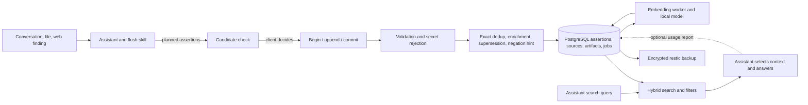

# Document B — End-to-end knowledge flow

## Current architecture (baseline)

MCP and FastAPI are adapters over common services ([architecture](../../../docs/architecture.md)). The hosted path uses Cloudflare Tunnel and Access with JWT validation at origin; direct devices use TLS and scoped bearer tokens on a private hostname. Neither gateway can make the assistant extract all relevant source facts. The server never fetches submitted URLs. Stored text is flagged as untrusted data.

## Stage ledger

| Stage and owner | Current data / guarantee | Loss or failure; detection and recovery | Recommended change |
|---|---|---|---|
| Original material; assistant/client | Conversation context available to the model; optional files and external sources. No source inventory reaches server. | Compaction, inaccessible attachments, wrong source version. Client can disclose available context; server cannot prove coverage. | M1 synthetic source fixtures and explicit coverage rubric. M3 optional source manifest only if missed extraction is measured. |
| Extraction/classification; client skill and initialization instructions | Skill asks for atomic, self-contained claims, rationale, kind/origin/status, dates, evidence state, source references, and secret exclusion ([skill](../../../plugin/knowledge-vault/skills/flush-knowledge/SKILL.md), [policy](../../../src/knowledge_vault/ingestion_policy.py)). | Long contexts, translation, implicit corrections, over-fragmented procedures, proposals mislabeled as actions; no server-side LLM verification. Report rejections and context limits; no coverage meter. | M1 separate extraction gold set; improve client examples only where errors occur. Preserve a complete procedure with prerequisites rather than atomizing every sentence. |
| Reconciliation/dedup; client then server | `check_knowledge_candidates` returns exact and nearby matches; client chooses skip/refine/replace. Server merges only normalized exact text and never silently merges vectors ([search](../../../src/knowledge_vault/services/search.py), [ingestion](../../../src/knowledge_vault/services/ingestion.py)). | Paraphrase duplicates, missed candidates, incorrect client supersession. Per-item receipts and `readback_ids` expose storage outcomes, not semantic correctness. | Measure duplicate decision precision. No automatic semantic merge. Structured temporal evidence must retain distinct source observations even if text matches. |
| Validation/persistence; shared service and PostgreSQL | Bounded fields, per-item secret rejection, numbered idempotent parts, atomic commit and retry receipts; source URLs and typed provenance optional. | Rejected items, exhausted part limit, incomplete batch, secret detector misses; append rejects individually, commit counts and worker expiry recover staged state. | Keep invariants. M3 adds optional source-level audit receipts without copied transcripts if justified. |
| Temporal/lifecycle; baseline status plus WIP resolver | Legacy status and valid dates are filters; plans can carry workflow state. Temporal branch proposes immutable keyed evidence and read-time deterministic resolution. | Legacy plan can remain current after completion; status does not mean implementation state; historical queries can include unknown-bound rows. | T0 verifies branch and client routing. M4 repairs only benchmark-identified high-value records. |
| Indexing; PostgreSQL worker | Generated `simple` tsvector, 384-dimensional model vector, model tag, persistent queue, retry/dead state, text fallback ([tables](../../../src/knowledge_vault/persistence/tables.py), [worker](../../../src/knowledge_vault/worker/jobs.py)). | Queue delay, model failure or mismatch; queue counts, heartbeat and degraded flag show operational failure. Model quality is not measured. | M1 index freshness diagnostic; M2 candidate ablations. No model switch or ANN index without evidence. |
| Retrieval/ranking; search service | `websearch_to_tsquery('simple')`, `ts_rank_cd`, cosine candidates, top 50–250 per channel, 0.55/0.45 RRF, filters, signed cursor ([search](../../../src/knowledge_vault/services/search.py), [ranking](../../../src/knowledge_vault/services/ranking.py)). | Multiword lexical AND may find none; vector-only hits can be unrelated; no threshold or query intent. Cursor is stable only while corpus unchanged and only within candidate pool. Search latency metric detects delay, not relevance. | M2 lexical query experiments, candidate diagnostics, calibrated abstention/threshold and fusion ablation. |
| Context assembly/answer; assistant/client | Compatibility `search` returns IDs, `fetch` text and metadata; focused search returns structured assertions. No server control over search decision, query rewrite, context budget, citation selection or answer wording ([MCP adapter](../../../src/knowledge_vault/mcp/server.py)). | Missed retrieval and hallucinated synthesis remain possible after successful search. No systematic detection. | M1 end-to-end client harness; client contract: cite IDs, state temporal uncertainty, abstain on missing/contradictory evidence, distinguish retrieved from used. |
| Feedback/operations; client plus service | Usage counts returned IDs; explicit `report_knowledge_usage` requires write scope; fixed-label metrics, watchdog, backups ([maintenance](../../../docs/knowledge-maintenance.md), [monitoring](../../../docs/runbooks/monitoring.md)). | Zero reported uses does not mean no use; no correctness labels. Failures in usage accounting do not block reads. | M5 opt-in, content-minimal feedback tied to benchmark cases; avoid query-text telemetry. |

## Reliability boundaries

The batch commit is the atomic durability boundary for **submitted** assertions. It does not certify original-source coverage, extracted meaning, provenance quality, vector readiness, search recall, or answer correctness. A fallback search can succeed operationally while retrieving the wrong records. Conversely, a good record can be absent from the top K. The evaluation design therefore treats extraction, retrieval, temporal resolution, and answer generation as separate experiments ([benchmark](benchmark.md)).

Deletion removes live assertion content and cascaded derived rows under the documented admin confirmation flow; earlier encrypted backup snapshots retain deleted content until retention or deliberate pruning ([backup runbook](../../../docs/runbooks/backup-restore.md)). Avoid storing raw source text merely to make coverage easy; use bounded references and an operator-local gold corpus.
