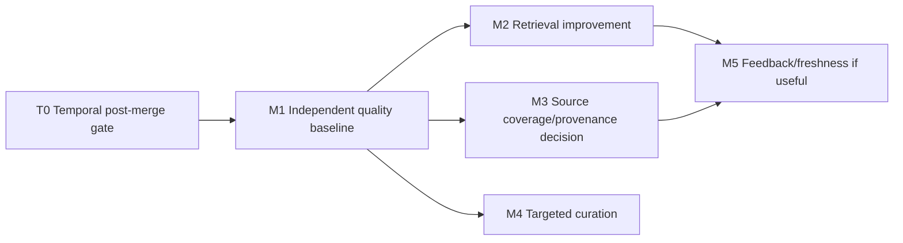

# Document D — Dependency-aware engineering roadmap

## Order and critical path

T0 is a **checkpoint, not a second temporal implementation**. M1 is the first new implementation milestone after temporal merge. M2 is the likely first product behavior change, but must be chosen by M1 evidence. M3 can run independently after M1 if source omissions justify it. M4/M5 are conditional. Relative effort: **S** 1–3 engineer days; **M** 4–10 days; **L** 2–4 weeks, excluding review/deployment wait. Confidence describes the estimate, not expected product benefit.

| ID / priority | Problem and audit evidence | Outcome and recommended solution; alternatives | Dependencies / components / API and migration | Acceptance, tests, metrics, rollback | Effort / confidence / risk |
|---|---|---|---|---|---|
| **T0 required** [spec](milestones/T0-temporal-integration.md) | Temporal branch `ce6d35a` is unmerged relative to baseline. Legacy search cannot reconstruct current/historical state. | Review/merge through normal PR, run full gates, disposable upgrade/restore, authenticate through deployed MCP path, refresh client schema/skill and test end-to-end state. Alternative is leaving legacy state unresolved; do not reimplement branch. | Temporal owner/maintainer; migration 0006, MCP/HTTP, client guidance; additive schema already on branch. | Permutation, backfill, correction, historical, auth and rollback checks; no production write by this review. Keep expanded schema on application rollback. | M, medium; deployment/migration risk. |
| **M1 highest** [spec](milestones/M1-quality-baseline.md) | No independent ground truth, extraction coverage or answer-quality metric. Live usage counts do not imply utility. | Build synthetic source packs, adjudicated truth cards, isolated ingestion/retrieval/client harness and redacted score report. Alternative: ad hoc manual search review is too biased. | T0; `tests/quality/`, evaluation scripts, fixture docs; **no schema or public API**. | 60–100 synthetic scenarios, ten categories, reproducible baseline with versioned model/corpus; CI smoke and local full suite; KPI definitions in [benchmark](benchmark.md). Roll back harness without data migration. | M–L, medium; annotation burden. |
| **M2 high if benchmark confirms** [spec](milestones/M2-retrieval.md) | Search uses multiword lexical AND, top-250 candidate cap, fixed RRF and no relevance floor; four diagnostics had vector-only top scores. Actual recall cost unmeasured. | Compare lexical OR/coverage, phrase handling, candidate pool, calibrated threshold and fusion on frozen cases; ship smallest winning change. Alternative model swap/reranker only if ablations justify. | M1; search/ranking, shared responses if additive diagnostics, contract/integration tests; normally **no migration**. | Held-out Recall@10/nDCG gain with no critical slice regression, p95 budget, degraded fallback, pagination and security tests. Feature flag or reverting code restores prior ranking; never rebuild vectors merely to test lexical changes. | M, medium; ranking regressions. |
| **M3 high if source omissions measured** [spec](milestones/M3-source-coverage.md) | Commit proves submitted items, not source coverage; provenance optional. 75 of 80 sampled hits lacked both typed provenance and URL source (query-biased). | Improve client source checklist first; if omissions persist, add content-free source-import receipt and assertion/evidence linkage. Alternative references only if checklist solves gap. | M1 and T0; skill/policy, domain models, ingestion, Alembic new revision, shared MCP/HTTP responses; additive API. | Source-pack coverage and rejection accounting; replay, deletion, backup/restore, old-client compatibility; no transcript storage. Roll back client feature then code, keep additive table until retention. | M–L, low-medium; privacy and migration risk. |
| **M4 conditional** [spec](milestones/M4-curation.md) | Legacy `current` plans and optional context/facet can confuse applicability; no contexts in live snapshot. Existing maintenance tools and temporal resolver already address part of need. | Select high-impact failures, repair via reviewed metadata/temporal evidence and explicit aliases; automate only suggestions. Alternative new lifecycle state machine/entity registry deferred. | M1, T0; maintenance review and client guidance; **no new schema by default**. | Gold cases for plan vs implementation, scope/alias, correction; no fabricated dates or silent merge. Rollback reviewed metadata via new correction/reviewed update, preserve history. | S–M pilot; medium; curation judgment risk. |
| **M5 conditional** [spec](milestones/M5-feedback-freshness.md) | Retrievals ≠ uses; no reported uses, no answer feedback. `review_after` exists but live count zero. | Add opt-in content-minimal feedback workflow and category-based review policies for volatile claims, retaining history. Alternative broad telemetry/TTL rejected. | M1, preferably M2/M3; client integration, observability/maintenance; API/schema only if event receipts demonstrably needed. | Correction-to-regression-case loop, review due precision, no query text in metrics, no automatic deletion; can disable telemetry and revert policy. | M, low-medium; privacy and adoption risk. |

## Why this order

Temporal state semantics must settle before quality labels for current/history are frozen. The benchmark then distinguishes missing extraction from retrieval failure and answer misuse. Search changes are easy to reverse and likely high value, but without gold cases a new ranking could make one anecdote better while hiding regressions. Source receipts require a migration and privacy review, so they follow a measured omission. Existing metadata, contexts, aliases and links make broad new ontology or lifecycle schema premature. M5 depends on stable KPIs and an actual feedback workflow; raw counts alone would create noise.

## Minimum viable plan and stop rules

Required minimum: **T0 + M1**, then **one M2 experiment** only if held-out failures show retrieval is limiting. Stop M2 if lexical changes do not improve the paired benchmark within latency budget; inspect extraction and client context selection instead. Stop M3 after client-only source checklist if coverage meets target; do not create a manifest merely to count imports. Stop M4/M5 until representative cases show value. No model replacement, graph database, distributed queue, new database, or global TTL is planned.
