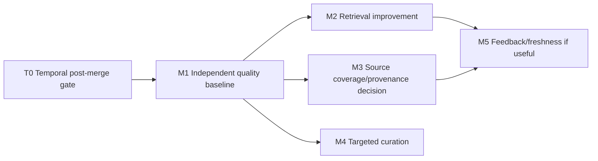

> **Status (2026-11-07): BOUNDED ROADMAP COMPLETE — conditional work deferred.** T0 temporal integration, M1 synthetic solo-operator quality baseline, and bounded M2 retrieval improvement are completed within their stated acceptance scopes; M2.1 synthetic real-MCP-client validation is completed. M3 source coverage, M4 curation and M5 feedback/freshness are **not implemented as new milestones** and are deferred until source-backed failures or validated usage justify them. This is engineering scope closure, **not** a claim of independently verified real-world extraction accuracy or new production deployment. Synthetic lifecycle harness PR #96 is merged (squash `148af787fc8f512d15f19f6fe0dc9dbd53ddff58`); independently reviewed gold and real-client source handoff remain optional research. Reopen M3 for measured source omissions/provenance gaps, M4 for source-backed incorrect applicability/temporal/identity behavior, and M5 for a demonstrated opt-in feedback workflow. Evidence: coordination PR #51, `reviews/m34-discovery-2026-11-06/README.md`, and `reviews/m21-assistant-2026-11-06/README.md`.

## Post-closure follow-up: multilingual retrieval relevance (2026-11-07)

**OPEN INVESTIGATION, not reopened mandatory M2.** After explicit authorized flush, 16/16 assertions committed (0 rejected/conflicts), and 3,152/3,152 embeddings completed. In an eight-query post-indexing maintenance search smoke test, six queries had at least a partially relevant record in top five. English `PR 96 synthetic lifecycle importlib CI` found the intended assertion at rank 2; Russian `Что было исправлено в CI PR #96?` missed it in top five and returned unrelated results. Russian `Какие ограничения были у оценки качества M2.1?` also missed the intended M2.1 limitation assertion in top five. Other Russian questions succeeded. This convenience sample is not representative and does not identify root cause.

See [next-agent multilingual retrieval handoff](../../runbooks/multilingual-retrieval-handoff-2026-11-07.md). Reproduce on disposable synthetic fixtures with frozen bilingual gold, inspect lexical/vector/candidate fusion separately, implement only a tested reversible fix, or close as non-reproducible. Do not infer extraction completeness from retrieval tests, reopen M3–M5, or deploy without authorization. The bounded roadmap remains closed.

# Document D — Dependency-aware engineering roadmap

## Order and critical path

M1 source-truth remediation clarified synthetic observation times, preference attribution and
fixture namespaces. See the [contract and digest change](source-truth-contract.md): old client
inputs are incompatible with the corrected corpus; real client execution and scoring remain
required before acceptance. Coordination artifacts never substitute for that evidence.

M1 engineering acceptance for this personal deployment defaults to `solo_operator`: one recorded
evaluator, reproducible checks, explicit model/human provenance and review of ambiguous failures.
The strict `independent_review` protocol remains optional research-grade validation. Neither
acceptance nor generalization follows from packet generation or backend-only results; real
MCP-client traces must be collected and scored. This decision does not alter the 41 development
cases, 123 planned runs, retrieval ranking or the separation of lexical-only and hybrid arms.

T0 is a **checkpoint, not a second temporal implementation**. M1 is the first new implementation milestone after temporal merge. M2 is the likely first product behavior change, but must be chosen by M1 evidence. M3 can run independently after M1 if source omissions justify it. M4/M5 are conditional. Relative effort: **S** 1–3 engineer days; **M** 4–10 days; **L** 2–4 weeks, excluding review/deployment wait. Confidence describes the estimate, not expected product benefit.

| ID / priority | Problem and audit evidence | Outcome and recommended solution; alternatives | Dependencies / components / API and migration | Acceptance, tests, metrics, rollback | Effort / confidence / risk |
|---|---|---|---|---|---|
| **T0 required** [spec](milestones/T0-temporal-integration.md) | Temporal branch `ce6d35a` is unmerged relative to baseline. Legacy search cannot reconstruct current/historical state. | Review/merge through normal PR, run full gates, disposable upgrade/restore, authenticate through deployed MCP path, refresh client schema/skill and test end-to-end state. Alternative is leaving legacy state unresolved; do not reimplement branch. | Temporal owner/maintainer; migration 0006, MCP/HTTP, client guidance; additive schema already on branch. | Permutation, backfill, correction, historical, auth and rollback checks; no production write by this review. Keep expanded schema on application rollback. | M, medium; deployment/migration risk. |
| **M1 highest** [spec](milestones/M1-quality-baseline.md) | No audited source truth, extraction coverage or answer-quality metric. Live usage counts do not imply utility. | Source-first truth audits and reproducible `solo_operator` client evaluation; optional strict `independent_review` research mode. | T0; `tests/quality/`, evaluation scripts, fixture docs; **no schema or public API**. | Existing 63 synthetic packs; frozen 41 dev cases × 3 repetitions, actual client traces, provenance-separated judgments, missing-run accounting and operator decision against [benchmark](benchmark.md) KPIs. Roll back harness without migration. | M–L, medium; source-audit burden. |
| **M2 high if benchmark confirms** [spec](milestones/M2-retrieval.md) | Search uses multiword lexical AND, top-250 candidate cap, fixed RRF and no relevance floor; four diagnostics had vector-only top scores. Actual recall cost unmeasured. | Compare lexical OR/coverage, phrase handling, candidate pool, calibrated threshold and fusion on frozen cases; ship smallest winning change. Alternative model swap/reranker only if ablations justify. | M1; search/ranking, shared responses if additive diagnostics, contract/integration tests; normally **no migration**. | Held-out Recall@10/nDCG gain with no critical slice regression, p95 budget, degraded fallback, pagination and security tests. Feature flag or reverting code restores prior ranking; never rebuild vectors merely to test lexical changes. | M, medium; ranking regressions. |
| **M3 high if source omissions measured** [spec](milestones/M3-source-coverage.md) | Commit proves submitted items, not source coverage; provenance optional. 75 of 80 sampled hits lacked both typed provenance and URL source (query-biased). | Improve client source checklist first; if omissions persist, add content-free source-import receipt and assertion/evidence linkage. Alternative references only if checklist solves gap. | M1 and T0; skill/policy, domain models, ingestion, Alembic new revision, shared MCP/HTTP responses; additive API. | Source-pack coverage and rejection accounting; replay, deletion, backup/restore, old-client compatibility; no transcript storage. Roll back client feature then code, keep additive table until retention. | M–L, low-medium; privacy and migration risk. |
| **M4 conditional** [spec](milestones/M4-curation.md) | Legacy `current` plans and optional context/facet can confuse applicability; no contexts in live snapshot. Existing maintenance tools and temporal resolver already address part of need. | Select high-impact failures, repair via reviewed metadata/temporal evidence and explicit aliases; automate only suggestions. Alternative new lifecycle state machine/entity registry deferred. | M1, T0; maintenance review and client guidance; **no new schema by default**. | Gold cases for plan vs implementation, scope/alias, correction; no fabricated dates or silent merge. Rollback reviewed metadata via new correction/reviewed update, preserve history. | S–M pilot; medium; curation judgment risk. |
| **M5 conditional** [spec](milestones/M5-feedback-freshness.md) | Retrievals ≠ uses; no reported uses, no answer feedback. `review_after` exists but live count zero. | Add opt-in content-minimal feedback workflow and category-based review policies for volatile claims, retaining history. Alternative broad telemetry/TTL rejected. | M1, preferably M2/M3; client integration, observability/maintenance; API/schema only if event receipts demonstrably needed. | Correction-to-regression-case loop, review due precision, no query text in metrics, no automatic deletion; can disable telemetry and revert policy. | M, low-medium; privacy and adoption risk. |

## Why this order

Temporal state semantics must settle before quality labels for current/history are frozen. The benchmark then distinguishes missing extraction from retrieval failure and answer misuse. Search changes are easy to reverse and likely high value, but without gold cases a new ranking could make one anecdote better while hiding regressions. Source receipts require a migration and privacy review, so they follow a measured omission. Existing metadata, contexts, aliases and links make broad new ontology or lifecycle schema premature. M5 depends on stable KPIs and an actual feedback workflow; raw counts alone would create noise.

## Minimum viable plan and stop rules

Required minimum: **T0 + M1**, then **one M2 experiment** only if held-out failures show retrieval is limiting. Stop M2 if lexical changes do not improve the paired benchmark within latency budget; inspect extraction and client context selection instead. Stop M3 after client-only source checklist if coverage meets target; do not create a manifest merely to count imports. Stop M4/M5 until representative cases show value. No model replacement, graph database, distributed queue, new database, or global TTL is planned.
