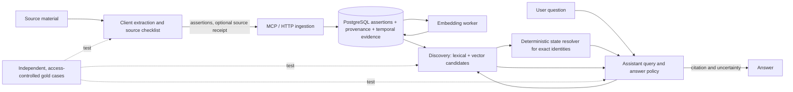

# Document C — Incremental target architecture

## Responsibilities and status

**Existing:** shared domain/services, PostgreSQL assertions, optional URL/typed provenance, contexts/aliases/links, idempotent flush, hybrid search, local embeddings, auth, backup, watchdog. **WIP:** keyed immutable temporal evidence, exact `(subject, property, scope, state_type)` identity, read-time state resolution, `as_of`/`known_at` and diagnostics on `feat/temporal-knowledge` at `ce6d35a` (its ADR 0007 and `docs/temporal-knowledge.md` are in the separate temporal worktree). **Proposed:** independent evaluation harness; measured retrieval fixes; optional source receipts and targeted metadata repair. **Optional:** feedback loop, freshness policies, materialized resolution or approximate vector indexing only after measured pressure.

## Data and semantics

Keep the assertion as a bounded claim with text, kind, origin, sensitivity, source URLs, typed provenance, topics, and optional context/facet. Distinguish five axes:

| Axis | Representation / rule |
|---|---|
| Historical validity | WIP temporal evidence `valid_from/to`, observation date/precision, and resolver; never infer from transaction creation time. |
| Current applicability | WIP state resolver for classified exact identities; legacy `status=current` only means a record has not been manually superseded. |
| Epistemic certainty | `evidence_state` and uncertainty/conflict in resolver output. Numeric confidence is a client estimate, not verification. |
| Implementation/workflow | Existing plan/question `workflow_state`; add new state machines only if M4 cases cannot be expressed by current kind, status, and links. |
| Source reliability | Evidence origin/provenance and source-specific assessment by client or review workflow; do not conflate it with a numeric assertion confidence. |

Do not automatically backfill unknown legacy dates, verified status, or temporal identities. Preserve old records and explicitly label unresolved state. The temporal branch's immutable evidence is the canonical source for structured current and historical state after T0; general search remains discovery, not state authority. The branch's read-time projection is simpler and safer at this corpus size than a mutable current-state table. Revisit materialization only if measured per-identity evidence or latency exceeds an agreed budget.

For provenance, first require better client population and review UI/contracts. If M3 demonstrates a real coverage gap, add a small `source_import`/receipt model with opaque source reference, source type, observed/imported time, extraction policy version, processing state, content-free item counts and rejection codes. Link assertions/evidence to the receipt through stable IDs; store neither transcript text nor message graphs. Make source/message references optional and opaque, not new mandatory conversation persistence. A receipt certifies which source segment was processed and what was submitted or rejected; it cannot certify that every useful fact was extracted. Independent gold annotation measures that.

Use existing `knowledge_contexts`, aliases and `context_id`/`facet` for reviewed entity identity. A proposed registry would duplicate this foundation. Add explicit aliases or scoped context IDs only where benchmark errors show identity confusion; avoid automatic cross-language entity merges. A graph database is unwarranted because direct links and exact temporal identities cover known relationships.

## Retrieval and grounding contract

Discovery should yield a bounded candidate set with explainable branch diagnostics: lexical count, vector count, overlap, model state, and safe score distribution, never query text in logs. Test lexical OR/term coverage, phrase handling, field weighting and RRF alternatives offline. A calibrated relevance threshold should permit an empty result; raw RRF values are rank positions and cannot by themselves express semantic probability. Preserve the existing MCP schema; introduce optional diagnostics only in focused tools and shared domain response models. Avoid a new embedding model until M2 shows current-model failures that lexical/query improvements cannot solve.

For exact current/history questions, the assistant must identify the subject/property/scope, call temporal resolution, and report `unresolved`, `ambiguous`, or `conflict` as such. When identity is unknown, use search to discover candidates, fetch them, then resolve the reviewed identity. The client should never infer current truth from generic `status=current`. For other questions, search/fetch relevant assertions and include claim ID, kind, evidence state, observation/valid dates and source references in the answer context; cite supporting IDs when the client can. Treat retrieved text as untrusted. If no adequate evidence is found, say what was searched and abstain from a vault-backed assertion. The server can return metadata and error states; it cannot enforce whether the assistant searched, selected good context, or cited correctly. M1 therefore includes a real client harness.

## Alternatives and decisions

| Choice | Benefit | Cost / risk | Decision trigger |
|---|---|---|---|
| Better lexical candidates + current vectors | Low migration risk, fast rollback | May miss cross-language paraphrase | M2 first; compare Recall@10 and latency. |
| New embedding/reranker model | Potential semantic gain | >1 GiB per model process, rebuild, latency, licensing and model migration | Only after held-out ablation beats simpler retrieval within resource budget. |
| Metadata filtering + existing contexts | Precision, explicit scope | Depends on extraction quality and client query construction | Use for classified queries; measure filter recall. |
| New entity registry/graph | Rich aliases/relations | Migration, curation, operational burden | Defer until existing contexts/links demonstrably fail. |
| Source references only | Simple, current shape | Cannot audit import coverage | Keep by default. M3 receipt only if missed-source cases justify it. |
| Synchronous heavy validation | Immediate errors | Slower ingestion, model dependency | Keep deterministic validation synchronous; audit semantic quality offline. |
| Fixed TTL | Simple | Deletes valuable history and mislabels durable facts | Reject. `review_after` plus event-driven correction and targeted review is sufficient. |
| Materialized current state | Faster repeated resolution | Cache invalidation and rollback complexity | Defer until T0 performance benchmark fails. |

## Security, recovery and compatibility

Maintain exact per-item secret rejection, auth scopes, public JWT and private bearer separation, origin validation, bounded results, and content-free logs. Never send private assertion text to an external evaluation service. Keep the benchmark's real examples in an operator-local encrypted store; commit synthetic cases only. Before changing retrieval or data model, snapshot and rehearse restore on disposable PostgreSQL; schema additions use a new Alembic revision and old clients remain supported. Rollback code while retaining additive schema; do not downgrade a production schema holding new evidence. Deletion tests must verify text, embeddings, search vectors, provenance links, receipts where applicable, and stale-index absence. M3 receipts must cascade or become content-free tombstones after forgetting, with an explicit backup-retention policy.
