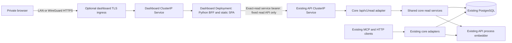

# Proposed deployment, security and risks

Status: proposed; revised for the [PR #126 review](https://github.com/kimonus/knowledge-vault-mcp/pull/126#issuecomment-7003860752).
No application, runtime configuration, ingress, Secret or cloud resource was changed. Read with
[ADR 0009](../../decisions/0009-optional-read-only-dashboard.md), the
[API/UI contract](api-ui-contract.md) and [review disposition](review-response.md).

## Independent runtime and trust boundaries



One new optional dashboard workload serves browser assets and a narrow BFF. Its image uses the
existing Python/FastAPI/httpx/PyJWT conventions with its own minimal lockfile; Node exists only
in its static-asset build stage. It does not start the core application, instantiate Container,
connect to PostgreSQL or load embeddings. There is no separate frontend server/Node runtime,
database, queue, model volume, PVC or background duty. Dashboard can be released/restarted and
removed independently of core API/MCP/worker resources. One replica is the initial supported
configuration; scale/rate-limiter coordination is outside this single-user design.

Core supplies an additive `/api/v1/read` inspection API over shared services before dashboard
deployment. It remains available to authorized inspection clients when dashboard is absent and
requires no dashboard assets/dependencies/settings. The API process's existing embedder serves
ranked queries; neither BFF nor Portal grouping has a model. Core API and embedding worker retain
their existing model lifecycle. Dashboard failure never affects core readiness, migrations,
ingestion, workers or backup. Core downtime makes dashboard data unavailable; no DB fallback.

The BFF implements explicit browser operations mapped to explicit core read operations, not a
generic reverse proxy. Reject arbitrary URLs/methods/headers and redirects. Upstream budgets,
response caps, cancellation and schema checking are defined in the API contract. Browser never
calls the core directly; CSP connect-src is self, CORS remains disabled and core does not accept
dashboard cookies/login credentials. NetworkPolicy cannot distinguish API paths on one core port,
so server-side credential/operation restrictions remain mandatory.

## Credential and database isolation

| Material / authority | Core API | Dashboard BFF | Browser |
|---|---|---|---|
| Core writer DB credential and core token pepper/records | Existing server Secret only | Never mounted/available | Never available |
| BFF service bearer, exactly `knowledge:read` | HMAC record in existing core token config | Dedicated existing Secret, raw issued read token only | Never returned or forwarded |
| Browser login record/pepper, exactly `knowledge:read` | Not registered | Dashboard-only existing Secret | User supplies login credential transiently over private TLS |
| Session signing key | Not mounted | Dashboard-only existing Secret | HttpOnly signed cookie, never signing key |
| Access verifier settings | Existing core settings unchanged | Own dashboard issuer/audience/email configuration | Provider session only; no write/admin bearer |

Browser-login and service tokens use distinct random values, principals and peppers/configuration
domains; a browser login token is not a core device token. Reuse pure HMAC/auth code with explicit
inputs, not the core Container or global settings. Login configuration must reject any write/admin
record or mixed-scope principal. Core inspection service credentials must likewise have the exact
scope set `{knowledge:read}`; admin-implies-read is insufficient. Generator defaults include write:
explicitly choose `--scopes knowledge:read` for both credential families. Never share a raw core
bootstrap Secret, writer token or token pepper with the dashboard.

Core inspection principals are an independently configured allowlist, provisioned with existing
rotating token records. Enforce their route restriction **before both HTTP and MCP scope handling**:
only fixed `/api/v1/read` data operations are permitted. Reject ordinary `/api/v1/search`, fetch,
usage, MCP, ingestion and admin routes even with a valid inspection token. That prevents a stolen
BFF service token from writing usage through ordinary read endpoints. Other clients retain current
behavior. Access identities are not an alternative service credential on this interface.

The dashboard has **no database role or connection credentials**. It has no network allowance to
PostgreSQL; do not add it to the existing DB NetworkPolicy component list. This satisfies the
least-privilege interface option in the review without adding a DB role/grant migration. A future
direct-DB design would require a separate SELECT-only role with no ownership, write/DDL privileges,
role escalation or write-capable function access; a writer role plus read-only transactions would
not suffice. Such an alternative requires a new reviewed decision.

Core read handlers force `purpose="maintenance"`; clients cannot select normal usage accounting.
Use a read-only transaction session factory in core for defense in depth, executing `SET TRANSACTION
READ ONLY` before queries and never changing pooled connection state persistently. Existing service
methods opening their own sessions must receive that factory or a factored read repository. No
write/usage/maintenance receipt is permitted; content-free operational counters/logs can change.
The trusted core still has its existing writer role for ingestion: read-only transactions there
are not claimed as DB privilege isolation for the BFF. Test pool reuse and existing writes.

## Browser authentication and sessions

Private LAN/WireGuard HTTPS is the default exposure profile; ingress itself is disabled until
explicitly configured. The dedicated hostname differs from both MCP hostnames.

1. In private mode the login page exchanges a dashboard-local exact-read credential for an
   app cookie. It never sends that login token upstream. Verify HMAC in constant time against
   dashboard-only records, reject write/admin/mixed scopes, return generic errors, clear the
   input and do not persist credentials in JavaScript storage, URLs or bundles.
2. Login requires JSON, custom `X-Dashboard-Request: 1`, exactly one matching configured HTTPS
   Origin and acceptable Fetch Metadata; refuse form/simple requests and sibling origins. No
   CORS permission allows cross-origin custom-header requests. Allow top-level login navigation.
3. Issue `__Host-kv_dashboard; Secure; HttpOnly; SameSite=Strict; Path=/`, without Domain, with
   1,800-second absolute expiry and no sliding renewal. Use PyJWT with an explicit algorithm,
   separate random signing key, audience/host, issue/expiry time, nonce and opaque keyed active
   login-record reference. No raw token or stored HMAC digest is in the cookie payload.
4. Verify signature, audience, expiry and still-enabled exact-read login record on every request.
   `/session` returns expiry/capabilities and a session-bound CSRF token to authenticated code,
   never the cookie/service bearer. POST queries require exact Origin and custom header; logout
   additionally requires that CSRF token. Validate any GET Origin; reject cross-site data fetches
   via Fetch Metadata. No knowledge-changing GET or HTML login redirect from a data API.
5. Removing the referenced login record or rotating the dashboard signing key invalidates sessions
   after a **dashboard-only rollout**. Token-record changes also change its opaque reference.
   Restart with unchanged key/records does not revoke sessions. Keys never enter core ConfigMaps
   or Pod-template checksums. Retain no session DB.
6. Logout expires the local cookie and clears in-memory knowledge. A copied cookie remains valid
   until absolute expiry unless the corresponding login credential is removed or key rotated.
   There is no single-session revocation list; document this limit rather than promise revocation.

Service-token rotation is separate from browser session revocation. Register overlapping exact-read
records in core, update the BFF-only service-token Secret and roll out BFF, then retire the old
core record through the normal operator credential workflow. Disabling Helm dashboard neither
deletes core records nor triggers core token rotation; operator may revoke its service identity
separately. Core 401/403 from a bad service token fails closed as 503 to the browser with a safe
operator-facing status, not as a browser login loop or a fallback to privileged credentials.

Login rate limits are bounded process memory keyed by trusted client address; do not trust
arbitrary X-Forwarded-For. Reuse the rate-guard convention for per-browser-principal BFF reads.
Core charges the fixed service principal's aggregate read budget too. No caller-controlled identity
forwarding or metric labels. Single-replica restart resets local limits, an explicit limitation.

## Optional Access browser profile and Host/Origin policy

Access is an operator-selected alternative browser auth mode, never an automatic public route.
BFF verifies signed `Cf-Access-Jwt-Assertion` issuer/audience/expiry/exact-email on **every** request
using existing verifier logic and dashboard-specific settings. It projects exactly READ, regardless
of Access's core read/write defaults. No private login/cookie/bearer fallback in this mode. Reuse
provider browser sessions; no new callback listener or app session database. Bind any app CSRF
nonce to verified identity/session/expiry. App logout clears local data but does not claim to revoke
the provider session; provider logout/revocation follows its documented policy. Access outage fails
closed. Upstream core calls still use the separate read-only service token, never the Access JWT.

Require exactly one canonical configured dashboard Host at the BFF, with existing case/port/trailing
dot normalization. Missing/repeated/malformed/unexpected Host and Origin fail closed, even with a
valid admin token or Access assertion. Do not trust client-supplied forwarding headers. TLS ingress
must route that host solely to the dashboard Service and restrict dashboard paths; core ingress
hosts stay unchanged. BFF has no core routers, OpenAPI exposure, MCP catch-all or write handlers.
Unknown API/static routes never become SPA HTML. Test encoded paths/dot segments/double slashes
and origin port/scheme mismatches. Only cluster `/health/live` and `/health/ready` probes are exempt
from browser Host/auth requirements; probes disclose no knowledge.

For BFF → core, connect to the existing ClusterIP with a fixed configured private core Host allowed
by current origin validation. Do not add the dashboard hostname to core public/private lists or
forward a browser Host/Origin/Cookie. Distinct ingress backends provide separation; core browser
routes remain absent. Existing core public-Host Access validation remains unchanged. Misconfigured
upstream URL/Host is a failed dependency, never permission to bypass core auth.

## Browser and content protections

- CSP: `default-src 'none'; script-src 'self'; style-src 'self'; connect-src 'self';
  img-src 'self'; font-src 'self'; base-uri 'none'; object-src 'none'; frame-ancestors 'none';
  form-action 'self'`. No inline/eval/CDN scripts, remote images or source previews.
- Set nosniff, no-referrer, restrictive Permissions-Policy and HSTS at the verified HTTPS edge.
  Knowledge/session/HTML/API responses use no-store. Only hashed application JS/CSS can be cached;
  no injected secrets/private configuration/knowledge, service worker, offline store or telemetry.
- Render assertions/provenance/artifacts as escaped plain text, even HTML/SVG/JS media types.
  No raw Markdown/dangerous HTML. Allow only HTTP(S) clickable sources with noopener/noreferrer;
  file/command/conversation/unknown locators remain inert. No automatic external fetches.
- Neither BFF nor core logs headers, bodies, query text, credential values or upstream payloads.
  Use fixed route labels, safe exception descriptions and bounded errors, including httpx errors
  that can otherwise include URLs/identifiers. Do not publicly serve production source maps.
- Sensitivity remains metadata, not authorization. The one authenticated user and BFF service
  principal can read all sensitivity classes. A filter is not a secrecy boundary. For selective
  sensitivity access, require a separate server-side authorization decision before enabling.

## Helm lifecycle and separate packaging

Illustrative proposal only:

```yaml
dashboard:
  enabled: false
  image:
    repository: ghcr.io/kimonus/knowledge-vault-mcp-dashboard # proposed artifact, not published
    tag: ""                  # pinned released version/digest required when enabled
    digest: ""
  host: ""
  authMode: privateSession    # privateSession | cloudflareAccess
  core:
    baseUrl: ""              # existing cluster-local API Service URL, fixed by operator
    host: ""                 # existing private core hostname, no auth-policy downgrade
    existingSecret: ""       # BFF-to-core exact-read bearer only
    tokenKey: service-token
  browserAuth:
    existingSecret: ""       # dashboard-only pepper and exact-read HMAC records
    pepperKey: token-pepper
    recordsKey: login-records
  session:
    existingSecret: ""
    signingKeyKey: signing-key
    maxAgeSeconds: 1800
  ingress:
    enabled: false
    className: ""
    tlsSecret: ""
    annotations: {}
  resources:
    requests: {cpu: 50m, memory: 128Mi}
    limits: {cpu: 500m, memory: 256Mi}
```

Resource values are unmeasured starting bounds. Access mode requires its own existing Secret
references for issuer/audience/email policy instead of browserAuth/private-session settings.
Core inspection-principal config/token records are ordinary independent core operator settings,
not derived from dashboard values or deleted on disable. Validate required values only when
enabled; disabled charts must not demand an image, hostname, keys, core credential or TLS Secret.

Every dashboard-owned manifest is guarded by `dashboard.enabled`: Deployment, ClusterIP Service,
ServiceAccount (`automountServiceAccountToken:false`), ConfigMap and dashboard-only NetworkPolicies.
TLS Ingress additionally requires `dashboard.ingress.enabled`; it targets **dashboard Service**.
Use distinct names/selectors/component labels and dashboard-only configuration checksums. Build
core ConfigMap checksum from core templates only: dashboard values/Secret changes must not alter
existing API/worker Pod templates, images, Services, migrations, backup or database resources.
The existing chart's migration Job is an unconditional `post-install,post-upgrade` Helm hook.
Do not claim ordinary `helm upgrade` avoids running it. For a dashboard-only toggle/image/config
upgrade on an already compatible core release, first compare renders and verify unchanged core
image/schema/config, then use `helm upgrade --no-hooks` under the documented dashboard-only
procedure. This avoids re-running core migration hooks solely for a UI change; no chart hook
modification is required. Never skip hooks for an actual core/schema upgrade. PR4 must rehearse
this exact lifecycle and report any core restart/resource difference; the invariant is not assumed.

NetworkPolicies: deny dashboard DB egress, allow DNS and only existing API Pods/port for reads;
Access mode additionally permits verifier JWKS HTTPS under existing project conventions. Allow
dashboard ingress only from configured ingress-controller peers and explicitly opted-in tunnel
peers; no NodePort/LoadBalancer/hostPort. If current restricted core ingress needs an allowance,
use a separate conditional additive ingress NetworkPolicy selecting core API Pods, admitting only
dashboard Pods on API port. This policy is dashboard-owned; existing core policy renders unchanged.
Removing it cannot remove pre-existing client permissions. Policies cannot restrict HTTP paths.

False renders zero dashboard resources. A Helm true→false upgrade removes only that owned set,
including optional ingress and additive policy. Operator-owned Secrets/DNS/certificates/core token
records are not deleted. No dashboard state/PVC needs preservation. Assert core resource renders
and Pod-template checksums identical across the toggle, independently upgraded dashboard versions
and dashboard Secret rotation; exercise core clients before/after removal. Core remains usable
with the dashboard absent, broken or never built. Enabling alone creates no public route/DNS.

Keep one Helm chart as deployment definition. Environment-specific controllers use values via
`extraObjects`; do not add parallel manifests or Compose profiles. None is tracked at the assessed
baseline; reassess actual merged support in PR4. Minikube remains the reference validation path.

Build a **separate dashboard image/Dockerfile** with pinned Node builder and Python runtime. Copy
only static artifacts into that Python runtime; install only locked BFF dependencies. No model,
DB driver/engine requirement, Node runtime or core Container. Keep existing core/worker image builds,
lockfile, packaging and runtime independent of dashboard build stages/assets/dependencies. Pure
auth helper sources can be included by the dashboard build with explicit minimal dependencies,
without installing the full core distribution, adding dashboard imports to core or maintaining a
second hand-copied auth implementation. Dashboard packaging
tests enforce that separation; core domain schemas remain authoritative for generated contracts.
Scan/SBOM/sign the dashboard artifact independently and retain non-root/read-only rootfs/dropped
capabilities/RuntimeDefault seccomp/probes/limits. Check shared Docker free space before future
builds and remove only review images afterward. No build/deploy is performed in this design task.

## Risks and unresolved decisions

| Risk | Resolution / remaining limitation |
|---|---|
| Optional feature mistaken for optional component | Separate image/Deployment/Service; zero-resource disabled render and unchanged-core comparison are required gates |
| Compromised BFF writes knowledge/usage | No DB credentials, exact-read core token restricted to inspection interface; core allowlist and non-recording transactions; token still permits reading the whole single-user vault |
| Session theft/revocation | Strict secure cookie, short absolute expiry, dashboard-only credential/key rotation; no immediate single-session revocation on logout |
| CSRF/XSS/Host confusion | Exact Host/Origin, custom headers/CSRF, CSP, inert text, no generic proxy; malicious browser extensions remain outside app protection |
| Extra network hop/core dependency | Bounded HTTP client and compatible schema versions, safe failure; no local fallback/cache; core reads still consume core capacity |
| False completeness/certainty | Live keysets, all statuses/uncategorized, paged sources/history and separate epistemic dimensions; no snapshot export or full edit archive |
| Packaging/dependency drift | Independent image and locks, shared contracts, CI compatibility; maintain minimal pure helper reuse without coupling builds |
| Exposure/configuration | Dedicated private hostname, opt-in ingress, no implicit tunnel changes; DNS/TLS/private reachability are operator responsibilities |
| Sensitive data visibility | All classes visible to authenticated owner; selective denial needs a new server policy |

Before implementation: re-review and accept ADR, independent BFF/core-read interface, route-bound
inspection credentials, live browsing and plain-text rendering. Before enabling: operator chooses
hostname/TLS/ingress, all-sensitivity visibility/session lifetime, dedicated dashboard login/pepper/
signing Secrets, read-only core service identity and supported core read API version. Defaults are
provided; this design phase needs no operator response. Public Access/tunnel/DNS modification is
a separate explicit exposure decision. Direct DB access is not an unresolved implementation option.

Measured questions for implementation: corpus/query/resource budgets and indexes, cold search
timeout, maintained Chromium/Firefox matrix, compatible core/dashboard version policy and whether
standalone support has merged. Defaults: protocol version 1 with capability check, one BFF replica,
bounded live paging, no export, and no additional infrastructure. ADR stays Proposed until re-reviewed.
