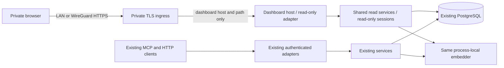

# Proposed deployment, security and risks

Status: proposed; no runtime configuration, ingress, Secret or cloud resource was changed.
See [ADR 0009](../../decisions/0009-optional-read-only-dashboard.md) and the
[API/UI contract](api-ui-contract.md).

## Runtime and trust boundaries



The dashboard is an adapter in the API process, not a new Deployment or SQL gateway. Browser code
has no DB connection details or SQL access. Enabling it does not change worker/migration/backup
ownership or make the worker fetch models. Static assets require no runtime network downloads.
Catalog/grouping queries do not embed anything. Ranked search may load the existing API model;
respect its single-load/single-encode discipline and current memory limits. Plain browse/Portal
must work with embeddings disabled or unavailable.

Runtime registration is conditional on a new `KNOWLEDGE_VAULT_DASHBOARD_ENABLED=false` setting.
Guarded configuration validates host, auth mode and required secrets only when enabled. When
disabled, dashboard routes are absent, credentials/keys are unnecessary, optional assets may be
absent, and the original MCP/API mount behaves as before. When enabled, absent assets or invalid
security settings fail startup clearly rather than serving an incomplete or anonymous UI.

Implement an outer host/path dispatcher before the existing MCP catch-all. It must reject
missing/repeated/malformed Host on the dashboard boundary and reserve configured dashboard
hosts exclusively for the dashboard (plus explicitly exempt cluster probes). It must reject
dashboard routes on MCP/private API hosts. Match canonical host case/port/trailing-dot rules
with existing helpers. Do not let forwarded Host select a different auth mode. Review ASGI
mount normalization, encoded path separators, double slashes, dot segments and redirect behavior;
ambiguous paths fail closed. Core public/private Host validation must remain intact.

On a dashboard host, route matching allows only static assets, explicit SPA routes, session
operations and named read-query handlers. There is no proxy to `/mcp`, `/api/v1`, OpenAPI, metrics
or admin endpoints. Even an Access JWT with write scope or a manually supplied admin bearer cannot
escape this dispatch boundary. Browser cookies are understood only by dashboard auth. Core auth
continues to require its existing Access/bearer identities; it never accepts dashboard sessions.

Read services receive a transaction-read-only session factory: start each DB transaction with
`SET TRANSACTION READ ONLY` before queries, without changing the shared connection's persistent
state. Pool reuse must never carry that setting into a writer transaction. Existing service
methods that open sessions internally must receive this factory or a factored read repository;
merely putting an outer transaction around a route is insufficient. Force non-recording purpose
for search/get and test with usage tracking enabled. Operational counters and content-free logs
may change; assertions, evidence, usage rows and maintenance receipts must not. Reuse the existing
database credentials server-side; do not put them in the UI or create an unrelated persistence
system. A separate SELECT-only DB role is optional later defense, not required infrastructure.

## Private browser login and session lifecycle

1. Operator creates a distinct read-only device token using the existing token workflow. The
   verification adapter must retain which record matched, so it can require the exact scope set
   `{knowledge:read}`. `Principal.permits(READ)` alone is unsafe because admin also permits read.
   Token generation must explicitly select `--scopes knowledge:read`; the existing generator's
   default includes write scope and is unsuitable for this login.
2. User opens private HTTPS `/dashboard/login`. The page contains no vault data. Login uses
   same-origin fetch, JSON and a custom `X-Dashboard-Request: 1` header. Require one exact Origin
   matching the configured HTTPS origin, reject cross-site Fetch Metadata and reject form/simple
   content types. No CORS permission exists to send this header from another origin.
3. Authenticate the token with existing constant-time HMAC checks; reject credentials with
   write/admin or mixed scope sets. Require the matched principal to identify a dedicated
   dashboard credential; configuration must reject mixing privileged records under that identity.
   Return generic auth errors, clear the password input and never echo/persist the token.
4. Issue `__Host-kv_dashboard` with `Secure; HttpOnly; SameSite=Strict; Path=/`, no Domain, and
   `Max-Age=1800`. The distinct host makes Path=/ safe without sharing a session with MCP.
   JWT or equivalent signed payload has an explicit algorithm, `aud`, `iat`, `exp`, session nonce
   and opaque active-credential reference. Use existing PyJWT rather than custom crypto. Key is
   a separate random signing Secret, not the token pepper. Enforce expiry independently on every
   request and do not accept unverified payload fields.
5. `/session` reports expiry, read capabilities and a nonce-bound CSRF token. The CSRF token is
   returned only after auth, held in memory and checked on logout. All query POSTs also require
   the exact Origin and custom header. Where an Origin is present on GET, validate it; refuse
   cross-site data fetches via Fetch Metadata. Allow top-level login navigation. No state-changing
   GET or browser API redirect is allowed. Test same-site sibling origins too, not only cross-site.
6. Active read-only record/key changes are effective after settings rollout. Sessions reference
   that record rather than embedding its raw token or HMAC digest. Changing token material,
   dropping that record, or dropping its dedicated principal invalidates its sessions. Cookie
   audience binds hostname and configuration; private mode and Access mode never interchange.
7. Logout requires CSRF validation, expires the cookie and clears in-memory knowledge. There is
   no server-side per-session revocation table. A stolen cookie remains useful until its 30-minute
   absolute expiry unless the credential is removed or signing key rotated. This limitation is
   explicit; do not advertise logout as revocation. Reducing lifetime is an operator choice.

Rate-limit failed login by a bounded client-address budget without trusting arbitrary
X-Forwarded-For. Existing authenticated read budgets remain per principal. Login limiter storage
is bounded process memory and resets on restart; the single API Pod is the supported reference.
Do not use attacker-chosen metric labels. No error/tracing/ingress logger records form bodies,
Cookie/Authorization/Access assertions, signing keys or query content.

## Optional Access browser profile

This is an alternative, explicit deployment profile, not the default public exposure. Operator
configures the new dashboard hostname as an Access browser application with an exact-identity
policy and supplies issuer/audience/allowed-email settings. Browser Access cookie is handled by
the edge; origin reuses its signed assertion verification on **every** dashboard request and
projects exactly READ authority. Session metadata uses verified identity/expiry, never unverified
JWT decoding. If a CSRF nonce is needed for app session actions, bind it with the dashboard key to
the verified Access identity/session and expiry; do not create a persistent app session database.

The private login route is unavailable in Access mode, and neither a dashboard cookie nor a
device bearer can bypass missing/invalid Access identity. Access outage fails closed for dashboard
data. Access session ending/revocation follows the provider's configured policy; the UI must not
claim its own local action revoked provider sessions. Leave provider logout as an explicit,
documented action and clear in-memory data when auth expires.

Existing `CloudflareAccessMiddleware` must be integrated carefully: its global public/private
host decisions cannot accidentally block private dashboard login or permit fallback on Access
dashboard hosts. Use explicit disjoint dashboard host dispatch/policies, reusing its authenticator
and host validation, rather than adding dashboard hosts to a permissive bearer allowlist. Test
mixed core-private, core-public, dashboard-private and dashboard-Access matrices. Reject host set
overlap or an auth-mode configuration that would downgrade a public assertion requirement.

## Browser/content protections

- CSP: `default-src 'none'; script-src 'self'; style-src 'self'; connect-src 'self';
  img-src 'self'; font-src 'self'; base-uri 'none'; object-src 'none'; frame-ancestors 'none';
  form-action 'self'`. No inline scripts, eval, CDN dependencies or fetched assertion images.
- Set `X-Content-Type-Options: nosniff`, `Referrer-Policy: no-referrer`, a restrictive
  Permissions-Policy, and HSTS at the HTTPS boundary after TLS configuration is verified.
- Return knowledge/API/session/HTML responses with no-store. Publicly cacheable hashed JS/CSS
  can contain only application code; never inject private config, token values or knowledge into
  them. No service worker, analytics SDK, session replay or third-party fonts.
- Escape plain text with React. Do not use dangerous HTML insertion, raw Markdown, dynamic script
  generation, automatic URL/image previews or executable artifact rendering. Artifacts are paged
  text even if their media type says HTML, SVG, JavaScript or shell. External source links use
  HTTP(S) allowlisting plus noopener/noreferrer. Other locators are inert text.
- No downloads/export in initial scope. No PostgreSQL details, token pepper or signing key in
  frontend environment variables/build output. Check generated source maps/bundles for secrets;
  production source maps are not publicly served.
- URL paths may contain resource IDs/topic keys; sanitize access logs to fixed route labels.
  Queries/filters use JSON bodies and are excluded from logs. Safe exception descriptions and
  fixed-label metrics follow existing observability conventions.

## Helm and packaging proposal

Illustrative values, **not implemented configuration**:

```yaml
dashboard:
  enabled: false
  host: ""                 # distinct private DNS hostname; required when enabled
  authMode: privateSession  # privateSession | cloudflareAccess
  session:
    existingSecret: ""     # separate signing key; never put a key value here
    signingKeyKey: signing-key
    maxAgeSeconds: 1800
  ingress:
    enabled: false
    className: ""
    tlsSecret: ""
    annotations: {}
```

The existing auth Secret holds dedicated read-only token records alongside ordinary device
records, using current HMAC/pepper conventions. Access profile references existing Access
issuer/audience/email Secret conventions; a distinct audience is used when the provider
application requires it. Final names must be confirmed in PR2/PR4; schema rejects incomplete,
overlapping or insecure combinations. Secret values never go into ConfigMaps/checksum annotations.
Signing-key rotation requires an explicit rollout; document that restarting with unchanged key
does not revoke stateless sessions.

Add a conditional dashboard TLS Ingress to the **same chart and same ClusterIP service**, routing
only `/dashboard` for `dashboard.host`. Keep existing core ingress paths/hosts unchanged. Merely
enabling dashboard does not set `ingress.enabled`, publish DNS, create NodePort/LoadBalancer, or
modify the tunnel's remotely managed routes. For Traefik/other environment-specific objects use
values through `extraObjects`, not a second manifest system. Private ingress admission and
LAN/WireGuard-only DNS/routing are operator responsibilities verified before enabling. Helm alone
cannot prove a hostname/IP is private or make a tunnel route private.

Extend values schema and config validation, explicit environment mapping, safe int64 rendering,
Secret references, NOTES and rollout behavior. NetworkPolicy stays least-privilege: reuse origin
ingress-controller peers and DB egress, do not open PostgreSQL to browsers or add dashboard egress.
Current any-namespace API ingress default is an operator hardening consideration, not permission
to widen it. No dashboard workload, PVC, worker duty or heartbeat is introduced.

Build static assets in a pinned Node build stage, copy only artifacts into the existing non-root
Python runtime, and keep Node/dev dependencies out of runtime. Retain a core-only build target
that omits the frontend stage, and make Python source installs runnable with dashboard disabled
without `web/dist`. The normal release image may package the inert bundle; flag remains false.
Pin bases/dependencies, extend SBOM/vulnerability/license checks to bundled JavaScript, retain
reproducible build inputs and read-only rootfs. Check Docker data-root free space before builds
on this shared host and remove only review-built images afterwards. Do not stop live containers.

No Compose files/profiles are proposed: none are tracked in the assessed checkout. Reinspect
merged support at implementation time. Do not substitute Compose for Minikube/pgvector validation.

## Risk assessment and unresolved decisions

| Risk | Control / remaining limitation |
|---|---|
| Browser reaches write APIs through shared origin | Dedicated host/path isolation, exact-read principals, explicit operation allowlist, core rejecting app cookies, read-only DB sessions; regression-test valid admin/Access credentials too |
| Stored XSS/provenance exfiltration | Plain text, strict CSP, inert artifacts, safe links, no preview fetching; authenticated browser compromise can still read visible data |
| Cookie theft/login brute force/CSRF | HTTPS, HttpOnly/Secure/Strict, Origin/header/CSRF validation, bounded rate limits, short expiry and credential/key revocation; no per-session revocation list |
| Silent incompleteness | Exhaustive browse/lexical mode, paged child collections, uncategorized buckets, explicit ranked/temporal overflow labels; no concurrent-snapshot or lost-history claim |
| False certainty | Separate metadata dimensions and explicit resolver; no LLM or UI winner selection; metadata quality still limits Portal quality |
| Query/embedding resource pressure | Bounded responses, parameterized SQL, timeouts, shared rate limits, indexed keysets, same embedder; measure catalog plans and shared-process search latency before enabling |
| Auth downgrade by Host/header confusion | Disjoint validated host sets, exact Origin/audience, trusted-edge policy, mixed-mode tests; ingress/TLS configuration still needs operator verification |
| Supply-chain increase | Locked minimal JS dependencies, pinned builders, SBOM/scans, no Node runtime; ongoing frontend dependency maintenance is added |
| UI/core release coupling | Conditional imports/registration/assets, core-only build, disabled compatibility tests; a frontend build issue must not prevent Python-only operation |
| Data privacy in caches/logs | No-store, no offline persistence, route-label logs, no credentials/content in telemetry; OS/browser memory and extensions remain outside app control |

Decisions to accept before implementation: ADR scope change permitting a UI, dedicated hostname
boundary, private read-only-credential login/stateless-session model, live pagination semantics,
and plain-text initial rendering. Recommended defaults are provided, so no design work is blocked.

Operator choices before enabling: private hostname/DNS/TLS/ingress class, dedicated credential and
signing Secret, acceptable session lifetime and coarse revocation model, and access to all
sensitivity classes. Sensitivity is a metadata filter, not a separate authorization boundary in
the current single-user model. If some records must be forbidden, define server-side sensitivity
authorization in a separate decision; a hidden filter is insufficient.

Questions left for measured implementation review: corpus size/query budget and need for indexes;
whether merged standalone support exists by PR4; supported browser matrix; whether live browsing
is sufficient or a consistent export is actually required. Defaults: current maintained Chromium
and Firefox, paginated responsive layout, live browsing and no export. No speculative benchmark
or private-data inspection is required to finish this phase.

Public dashboard exposure, Cloudflare policy/tunnel changes, live Secret issuance, deployment and
external publication require explicit operator authorization at that later stage. This design
does none of them.
